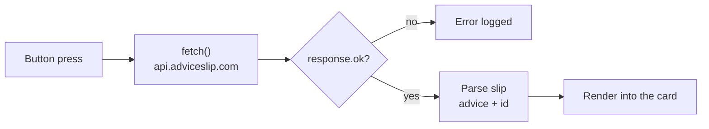
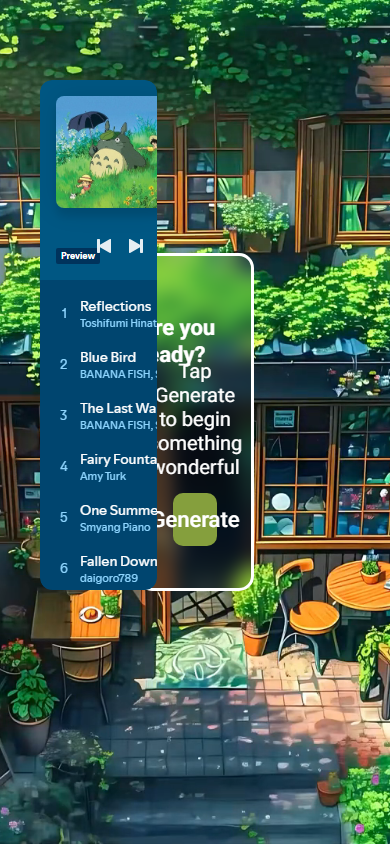

<h1 align="center">Advice Generator</h1>

<p align="center"><b>A full-screen landing experience with a looping video hero and a random advice card fed by a public API.</b></p>

<p align="center">
[](https://mister2314.github.io/Random-advice-generator/)


</p>

<p align="center">[**Live demo**](https://mister2314.github.io/Random-advice-generator/) · [Quick start](#quick-start) · [Features](#features) · [Architecture](#architecture) · [FAQ](#faq)</p>

<p align="center">
  <a href="https://mister2314.github.io/Random-advice-generator/">
    
  </a>
</p>

<p align="center"><sub>Live capture of the real build — 979 KB, loops forever.</sub></p>

## Overview

A single-screen site built around atmosphere: a muted, looping video fills the background, a glass card floats over it, and one button pulls a random piece of advice from a public API.

The fetch is handled explicitly — response status is checked before parsing, the returned `slip` is split into its advice text and ID, and both are written into the card. Errors are caught and logged rather than failing silently.

It was an early exercise in combining media, layout and a real network request in one page.

## At a glance

| Field | Detail |
| --- | --- |
| **Type** | Static site — no build step |
| **Primary language** | CSS |
| **Live demo** | [mister2314.github.io/Random-advice-generator](https://mister2314.github.io/Random-advice-generator/) |
| **Repository** | [Mister2314/Random-advice-generator](https://github.com/Mister2314/Random-advice-generator) |

## Features

- Full-screen looping video hero, muted and autoplaying
- Glass card overlay with the advice text
- Random advice fetched from `api.adviceslip.com` on button press
- Displays the advice ID alongside the text
- Explicit error handling around the network request
- Embedded Spotify playlist
- Roboto typography, responsive layout

## Tech Stack

| Layer | Technology |
| --- | --- |
| Markup | HTML5 (video, iframe) |
| Styling | CSS3 |
| Logic | Vanilla JavaScript, Fetch API |
| Deploy | GitHub Pages |

## Architecture



## Screenshots

| Desktop | Mobile |
| :---: | :---: |
|  |  |

## Quick Start

```bash
git clone https://github.com/Mister2314/Random-advice-generator.git
cd Random-advice-generator

# open it directly
start index.html      # Windows
open  index.html      # macOS

# or serve the folder
npx serve .
```

## Project Structure

```
index.html — video hero, advice card and Spotify embed
assets/js/index.js — button handler, fetch, response handling
assets/css/style.css — hero layout and card styling
assets/video/ — background video asset
```

## FAQ

<details>
<summary><b>Does it work offline?</b></summary>

No — the advice comes from a public API, so the card needs a network connection. The layout itself renders regardless.

</details>

<details>
<summary><b>What happens if the API fails?</b></summary>

The response status is checked before parsing and the error is caught and logged rather than failing silently.

</details>

## Roadmap

- [ ] Add a loading state on the button
- [ ] Add a copy-to-clipboard button for the advice text
- [ ] Cache the last few quotes as a fallback

## Author

**Xəyal Hüseynli** — Junior Front-End Developer

[Portfolio](https://hypnosdev.vercel.app) · [GitHub](https://github.com/Mister2314) · [LinkedIn](https://www.linkedin.com/in/x%C9%99yal-h%C3%BCseynli-3487b91ba/) · [xeyalhuseynli06@gmail.com](mailto:xeyalhuseynli06@gmail.com)
