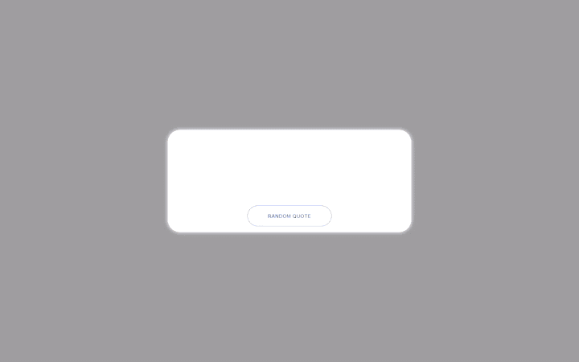
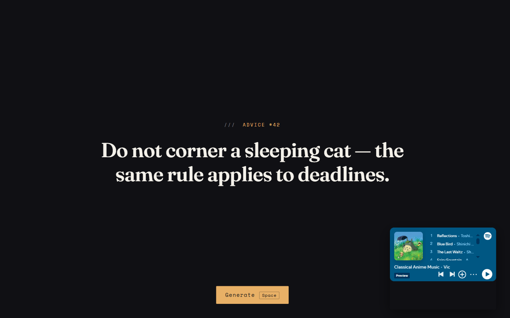
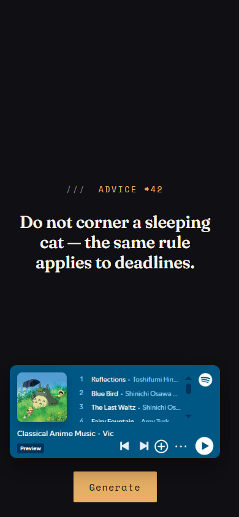
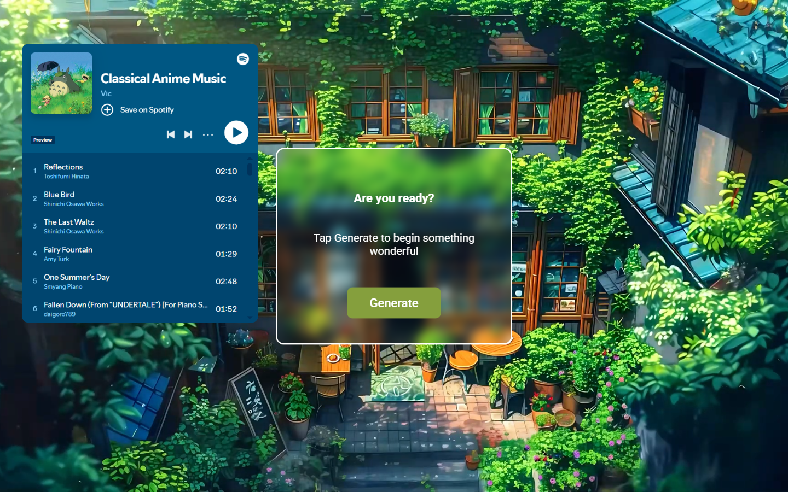
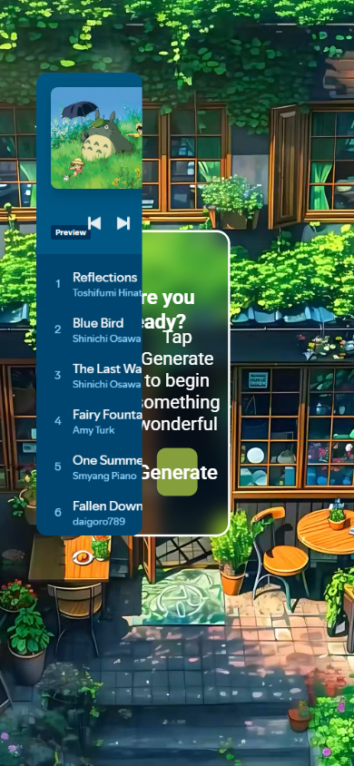

# Random Advice Generator

A quiet coffee-shop corner of the web: a dim café scene, a playlist playing in the dock, and one line of advice set in large serif type. Press the button — or just hit Space.

**Live demo:** https://random-advice-generator-tawny.vercel.app

<div align="center">



| Desktop | Mobile |
|---|---|
|  |  |

<details>
<summary>More screenshots</summary>

| Desktop | Mobile |
|---|---|
|  |  |

</details>

</div>

## What it does

One keypress pulls a random slip from `api.adviceslip.com` and the advice text — the actual hero of the page — rises line by line out of typographic masks. The café video is ambience, kept dim behind a dark grade so the type always reads. The Spotify dock is the soundtrack of the scene: it stays, docked bottom-right, collapsed to a compact player on mobile.

## Tech stack

React 19 · TypeScript · Vite · hand-rolled mask-reveal animation (no runtime animation deps)

## Features

- **Kinetic typographic advice line** — each word rises out of an `overflow: clip` mask, 0.9s `expo.out`, staggered 22ms; Fraunces display serif with optical sizing over Space Mono data labels
- **Fetch choreography** — cache-busted request (`?cb=` timestamp + `no-store`), breathing ink-bar skeleton while loading, inline retry button on failure, `aria-live` announcement of every state
- **Keyboard ritual** — `Space` or `R` generates from anywhere that isn't a control; visible focus rings; the real `<button>` keeps native activation
- **Intersection- and visibility-aware video** — `preload="none"` with a designed poster frame; plays only on desktop-class viewports while the hero is in view and the tab is visible; pauses on `visibilitychange`; mobile and reduced-motion users get the static poster
- **Offline memory** — the last slip is cached in `localStorage`, so a reload without a connection still shows real advice
- **Reduced motion** — masks, skeleton pulse and video are all disabled under `prefers-reduced-motion: reduce`; the unanimated page is the complete page

## Art direction

Ink (`#101014`) stage, paper (`#f4f1ea`) type, one amber accent (`#e8b066`). Two type families, two easings, one orchestrated moment — the advice reveal. Everything else stays still so the text can be read.

## Run locally

```bash
git clone https://github.com/Mister2314/Random-advice-generator.git
cd Random-advice-generator
npm install
npm run dev
```

## Verified

`tsc --noEmit` clean · production build clean · Playwright at 390 / 768 / 1440 / 1920: zero console errors, zero failed requests, generate + retry flows exercised against a mocked API, video pause/resume on visibility change, reduced-motion pass.

The advice card needs a connection — the API is public and remote. Everything else works offline.
